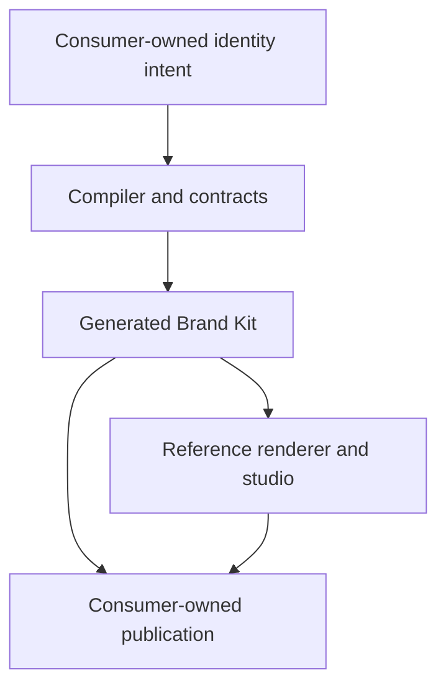

# Identity Architecture

## Purpose and scope

Identity uses a layered, contract-driven architecture to turn reviewed brand intent into verified Brand Kit projections and an understandable reference experience. This document owns structural boundaries, dependency direction, integration rules, authority boundaries, and current-to-target evolution. [SYSTEM.md](SYSTEM.md) owns logical responsibilities.

## Product architecture

The diagram expresses ownership and data flow, not a required framework or deployment topology.

## Internal layer model

1. **Intent and contracts** — identity source, schemas, accepted decisions, compatibility, and policy inputs.
2. **Domain** — canonical identity concepts, inheritance, overrides, approvals, projections, and provenance.
3. **Application** — validate, resolve, plan, render, verify, package, and handoff use cases.
4. **Ports and adapters** — filesystems, token transformers, vector/raster renderers, fonts, metadata, archives, providers, and frameworks.
5. **Interfaces** — CLI, library, packages, Brand Kit view model, reference renderer, reports, and automation contracts.
6. **Evidence** — diagnostics, tests, manifests, checksums, provenance, visual baselines, and health projections.

Dependencies point inward toward stable contracts and domain behavior. External libraries, frameworks, and providers do not become canonical domain truth.

## Data and authority flow

| Stage | Reads | May write | Must not do |
| --- | --- | --- | --- |
| Read | Canonical source and explicit configuration | Nothing | Resolve ambiguity silently |
| Validate | Parsed source and capability metadata | Diagnostics only | Mutate source or generated files |
| Resolve | Valid source, defaults, and overrides | In-memory resolved model | Hide inheritance or override conflicts |
| Plan | Resolved model and existing output state | Plan/evidence only | Apply changes |
| Render | Explicitly accepted plan and approved sources | Isolated generated work state | Publish or approve creative work |
| Verify | Source, outputs, manifest, fixtures, and policy | Validation evidence | Present partial coverage as success |
| Package | Verified outputs | Immutable package candidates | Replace canonical source |
| Publish | Approved immutable release and separately bound current evidence | Owning surface's deployment | Substitute mutable brand inputs for the selected release |

## Stable interfaces

- **Source contract:** versioned consumer-owned `.identity/` intent.
- **CLI contract:** local orchestration and human-readable/machine-readable diagnostics.
- **Compiler contract:** provider-independent domain and application ports, versioned plan/manifest schemas, adapter compatibility, and transactional generated-state recovery.
- **Package contract:** versioned profile selection and generated tokens, assets, metadata, guidance, indexes, checksums, deterministic archives, and compatibility as documented by [`docs/contracts/BRAND_KIT_PACKAGES_V1.md`](docs/contracts/BRAND_KIT_PACKAGES_V1.md).
- **Brand Kit view model:** framework-neutral public representation of an immutable release.
- **Renderer contract:** replaceable presentation of the view model.
- **Consumer contract:** pinned installation without access to repository internals.
- **Publication handoff:** explicit promotion and rollback metadata for an immutable release.
- **Evidence contract:** `identity.quality-report/v1` with stable statuses, coverage/skips, human-review boundaries, source/generated context, and release decisions as documented by [`docs/contracts/QUALITY_GATES_V1.md`](docs/contracts/QUALITY_GATES_V1.md); governed visual-motion producers additionally use `identity.motion-policy/v1` and `identity.visual-motion-manifest/v1` from [`docs/contracts/VISUAL_MOTION_V1.md`](docs/contracts/VISUAL_MOTION_V1.md).

Exact fields, commands, and package formats belong to their versioned specifications and roadmap issues.

## Repository ownership boundaries

| Repository/capability | Owns | Identity integration |
| --- | --- | --- |
| Hygiene | Organization policy, repository-presentation applicability, evidence semantics, and conformance requirements | Supplies exact versioned evidence/profile inputs; does not own product brand intent or visual rendering |
| Aether | Shared schemas, architecture vocabulary, and agent instructions | Governs document/contracts conventions through published artifacts |
| Holon | Reusable product components and templates | Consumes Identity tokens and packages; does not invent a second palette |
| Relay | Reusable CI/CD and release automation | Executes thin, pinned validation/release workflows; Relay #8 owns deterministic browser/demo capture that emits Identity-owned visual-motion provenance rather than defining a second motion policy |
| Pace | Fleet synchronization and conformance changes | Proposes or applies versioned consumer upgrades through explicit plans |
| Observatory | Organization health and evidence projection | Reads stable Identity validation and release evidence |
| Empathy | Baseline consumer and former incubation host | Owns its `.identity/` source and consumes an immutable Identity release |
| OptiFlow | Product consumer with distinct visual overrides | Demonstrates family defaults plus intentional product variation |
| Website repository | Organization public shell, route installation, deployment, redirect, and domain | Installs the reviewed `/identity/` product-experience artifact; does not own the standalone Brand Kit publisher |
| Identity | Brand contracts, projections, packages, view model, reference renderer, standalone publisher, and evidence | Uses versioned sibling interfaces and exact source bindings; retains the consumer-owned source boundary |

## Public-route boundary

`https://identity.egohygiene.io/` is the canonical public Brand Kit.
`https://egohygiene.io/identity/` is the separately owned product experience,
not a replacement Brand Kit host. Accepted
[ADR-0017](docs/decisions/ADR-0017-zensical-launchkit-publication-architecture.md)
and [ADR-0019](docs/decisions/ADR-0019-immutable-release-contract.md) preserve
the release, adapter, and two-surface boundaries. Proposed
[ADR-0022](docs/decisions/ADR-0022-decisions-publication-composition.md) records
the implemented Decisions composition without acquiring lifecycle acceptance.

| Surface and routes | Owner and inputs | Validation and current evidence | Rollback |
| --- | --- | --- | --- |
| Standalone Brand Kit: `identity.egohygiene.io/`, `/site.json`, `/packages/`, local `/brand-kit/` redirect | Identity's existing single Pages publisher and reference renderer select a published stable annotated tag. The current selected release is `v1.0.0`. | Release/configuration/asset binding, package checksums, canonical domain and served bytes. [Publisher run 38073076055](https://github.com/egohygiene/identity/actions/runs/38073076055) and [organization #30](https://github.com/egohygiene/.github/issues/30) record the October 10 deployment and 40 preserved Brand Kit files. | Select an earlier stable annotated release through the existing publisher; verify its output and independent Decisions source. Preserve a verified recovery artifact before changing release-owned bytes. |
| Organization product experience: `egohygiene.io/identity/` and its docs, architecture, legal, manifest, and redirect routes | Identity builds a content-addressed composite from pinned Holon profiles; the organization route owner installs the exact reviewed artifact. | Offline architecture/artifact verification, deterministic inventory, accessibility/browser review, exact cross-host release agreement, and owner installation/live proof. #57 delivered the bounded candidate; configured `v1.1.0` is not a published release or deployment. | The organization route owner re-promotes the preceding verified composite independently of the Brand Kit. |
| Current Decisions projection: `identity.egohygiene.io/intelligence/` and `/decisions/` alias | The same Identity publisher composes pinned Relay output from a full current ADR source revision. Publisher, ADR source, and stable Brand Kit release retain separate bindings. | Fresh ADR admission, public allowlisting, route-collision and Brand Kit preservation checks, retained artifact and live hashes. PR #97/run 38073076055 record source `55d0339ba5518c7b72154a2aad54a9e5b2bf2fff`; organization #30 records 62 matching live files. ADR-0022 remains proposed. | Retain the exact composed artifact and prior 40-file recovery capture. Replay a reviewed ancestor ADR source only through fresh admission; a retained archive does not prove an exercised rollback. |

The [publication guide](docs/publication/IDENTITY_PAGES.md) and existing
machine contracts own exact routes and commands. Broader Intelligence hosts,
routes, and fleet adoption remain separately scoped; the deployed Decisions
canary supplies no blanket publication authority. Read-only inventory,
Observatory, and ADR collection can proceed alongside #70 using their source
visibility and coverage contracts; they do not wait for every audit repair.

## Dependency rules

The operational admission, pinning, update, security, and replacement rules are
defined by the [dependency policy](docs/DEPENDENCY_POLICY.md).

- Sibling capabilities integrate through versioned public contracts, releases, packages, immutable commits, schemas, or documented APIs.
- Generated artifacts never become canonical source.
- Provider and framework adapters depend on application ports; core behavior does not depend on one adapter.
- Read, validate, resolve, plan, render, verify, package, approve, publish, and recover remain distinct when consequential.
- The reference renderer may use Holon components but Identity does not own or fork the component system.
- The compiler is deterministic and offline by default; networked generation is an explicit provider handoff.
- Transient state is ignored, disposable, and never promoted implicitly.

## Implemented compiler, package, quality, and motion boundary

The v1 compiler core is a public Rust library boundary described by
[`docs/contracts/COMPILER_V1.md`](docs/contracts/COMPILER_V1.md). It owns
framework-neutral models and ports for reading, validating, resolving, planning,
rendering, verification, manifests, adapter discovery, and generated-state
transactions.

Planning is mutation-free and records create, replace, remove, unchanged, or
blocked actions together with checksums, compatibility evidence, warnings, and
required approvals. Rendering and adapter verification complete before the
artifact store receives mutation authority. The local store stages verified
writes under `.cache/identity/transactions/`, backs up replacements/removals,
promotes the generated manifest last, and fails closed until an interrupted
transaction is explicitly recovered.

The built-in package layer consumes those ports rather than bypassing them. It
adds a framework-neutral `identity.brand-kit-model/v1`, nine semantically
versioned output profiles, and six offline adapters for token, metadata,
guidance, approved SVG, raster, and archive projections. Generated artifacts
include DTCG/CSS/JavaScript/TypeScript/Tailwind token packages, document CSS,
metadata and Open Graph projections, PWA/GitHub/social imagery, checksums,
package indexes, and a deterministic ZIP. SVG rasterization is isolated behind
the accepted `resvg` adapter boundary; archive bytes are produced by an
Identity-owned deterministic ZIP32 writer.

The compiler still rejects network-dependent or nondeterministic adapters. The
package layer does not make its output canonical or publish implicitly. Its
narrow `v1-generate` command is a consumer-owned transactional build boundary,
and `v1-verify` detects missing or drifted generated state without mutation.
`v1-inspect` and `v1-recover` expose the artifact-store boundary directly:
read-only complete preflight versus explicit exclusive rollback, independent
of canonical-source/Python availability. Inspection takes a shared lock only
when the persistent coordination file already exists; an absent lock yields a
qualified observation. Recovery always revalidates under exclusive ownership.
On current source generation, verification and the public v1 loader run the complete
embedded Python preflight automatically. PR #89 repaired public/review
filtering, source authority, and journal authority on main; it did not change
historical release bytes. Later #74–#79 repairs preserve digest, renderer-input,
transaction workspace, writer and distributed recovery boundaries; their current
states and evidence are recorded in ROADMAP.md, separately from released bytes.

The #12 quality layer sits downstream of the resolved Brand Kit and compiler
manifest. It owns `identity.quality-report/v1`, package/publication scopes,
release-blocking accessibility/provenance/license/reproducibility/visual checks,
explicit skipped coverage, visual-baseline comparison, and human-review
evidence. Source asset bytes remain separate from resolved source-governance
metadata so creative content and approval/license lineage do not collapse into
one authority object. Quality evaluation is read-only and cannot repair source,
rewrite generated artifacts, approve creative changes, or publish a release.

The #3 visual-motion layer extends that existing report rather than creating a
parallel validator. `identity.motion-policy/v1` constrains purpose-specific
duration/file-size budgets, cheap animated properties, easing, frame rate,
dimensions, deterministic capture modes, and reduced-motion behavior.
`identity.visual-motion-manifest/v1` records source license/approval, immutable
capture lineage, generator version, output digests/geometry/timing, behavioral
semantics, capture context, fallback digests, and baseline identity. Objective
checks are automated while motion meaning, direction/origin, and changed visual
baselines remain human decisions. Relay #8 is a downstream capture producer for
this contract, not an Identity runtime dependency.

Renderer interaction checks remain outside package scope and require actual
browser evidence in publication scope. #14 implemented that renderer path;
#80 now owns a reproducible browser/font environment, and #88 must preserve
its accessibility and visual behavior during extraction.

## Trust boundaries

Canonical source, generated work state, released packages, provider sessions, CI, and published surfaces are separate trust zones. Every crossing requires explicit data, authority, version, error, privacy, and recovery behavior. Credentials, private source material, and unapproved candidates never enter public artifacts or provenance intended for distribution.

## Current-to-target evolution

| Capability | Current evidence | Target |
| --- | --- | --- |
| Product contract | Accepted architecture documents | Maintained v1 boundary and compatibility policy |
| CLI foundation | Extracted workspace with `init`, `validate`, `plan`, and `handoff` parity evidence | Evolve through versioned contracts without losing the local-first authority boundary |
| Identity v1 source contract | Closed schemas, layered DTCG fixture, offline validator, adversarial diagnostics, and v0 migration plan | Preserve v1 compatibility while package and consumer layers consume the resolved model |
| Compiler pipeline | Deterministic Rust core, adapter registry, mutation-free plan, plan/manifest schemas, checksum evidence, transactional local store, recovery tests, and offline/compatibility gates | Preserve authority boundaries while downstream validation and interfaces evolve |
| Packages and projection validation | Nine versioned profiles, built-in offline adapters, DTCG/web/document/metadata/raster/archive projections, deterministic package/checksum schemas, cross-repository byte-identity tests, incremental tests, and subset-selection tests | Preserve package compatibility through real consumer/release proof |
| Repository presentation | Exact-pinned proposed Hygiene profile, reviewed banner inheritance, explicit evidence-state rendering, local SVG/PNG variants, accessible fallbacks, manifests, and checksums | Hand the immutable descriptor to Holon and repository tooling without transferring evidence or README authority |
| Quality and release evidence | `identity.quality-report/v1`, package/publication scopes, WCAG/reduced-motion/source-governance/SVG/PNG/manifest/budget checks, visual baselines, explicit skips, human-review tests, and renderer browser evidence | Preserve the single release authority and qualify the browser environment through #80 |
| Visual-motion governance | `identity.motion-policy/v1`, `identity.visual-motion-manifest/v1`, Astryx adopt/adapt/reject evidence, deterministic capture/provenance checks, purpose budgets, reduced-motion fallbacks, baseline review, and adversarial tests | Consume deterministic capture evidence from Relay #8 and renderer evidence from #14 without coupling Identity to their implementations |
| Renderer and studio | Implemented reference renderer, governed local previews/handoffs, and `studio-review` | Complete kit presentation through #99–#105; preserve approval and model compatibility during #88 |
| Publication | Release-backed standalone Brand Kit and separately bound Decisions deployment; organization composite has a candidate handoff | Preserve the surface matrix above; obtain a qualifying stable release and organization owner installation before claiming the `/identity/` experience live |
| Consumer proof and release | Merged Empathy/OptiFlow pilots and published `v1.0.0`; Mantle provides post-v1 adoption | Ship later repairs in a new immutable release and repeat the real self-consumer/upgrade proof under #98 |

Implementation evidence determines availability. An accepted architecture direction is not itself an implemented runtime capability.
