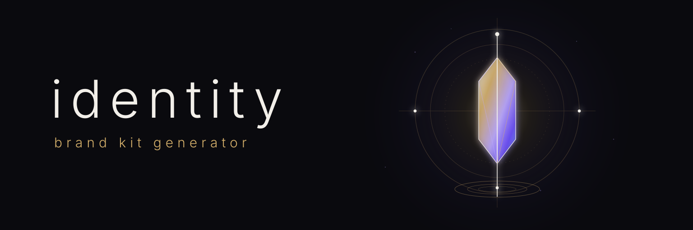

<p align="center">
  
</p>

# Identity

Identity specifies and validates a project's identity, then turns reviewed
source into reproducible design tokens, creative guidance, assets and a Brand
Kit. Each project owns its `.identity/` source and creative approvals.

<a id="product-contract"></a>
<a id="the-three-product-layers"></a>
<a id="state-and-authority"></a>
<a id="what-identity-owns"></a>
<a id="what-identity-does-not-own"></a>

## What it does

```text
Project-owned .identity/ → validate → generate → verify → Brand Kit
```

Define colors, typography, voice, usage, rights and approved assets in one
versioned source. Generate portable packages and a public kit from that source;
publishing remains an explicit step owned by the consuming project. See the
[product overview](docs/OVERVIEW.md) for layers, boundaries and capabilities.

The [public Identity Brand Kit](https://identity.egohygiene.io/) is the
standalone release-backed site. Its latest stable release, `v1.0.0`, predates
later source additions such as Kern; a merged source feature is not evidence
that the published release contains it. [Publication details](docs/publication/IDENTITY_PAGES.md)
explain the separate product-experience route at `egohygiene.io/identity/`.

<a id="cli-foundation"></a>
<a id="identity-v1-source"></a>
<a id="governed-brand-guidance"></a>
<a id="press-and-media-kits"></a>
<a id="social-surface-packages"></a>
<a id="organization-channels"></a>
<a id="repository-presentation-packages"></a>

## Use Identity in a project

Start with the [authoring worksheet](docs/consumers/AUTHORING.md) and
[minimal and expanded examples](examples/v1/README.md). The
[adoption guide](docs/consumers/ADOPTION.md) covers tool pins, generation,
verification and rollback. Then [assemble a complete Brand Kit](docs/consumers/COMPLETE_BRAND_KIT.md).

The [command guide](docs/USAGE.md) documents the existing CLI and optional
projections, with explicit consumer paths. `init` currently creates the legacy
v0 source; use the v1 authoring examples for v1 source. A future v1 initializer
is tracked separately in [#133](https://github.com/egohygiene/identity/issues/133).

## Work on this repository

From the checkout root, with [Task v3](https://taskfile.dev/) installed:

```bash
task --list
task setup
task preview
```

`setup` installs pinned tools and frozen dependencies, then builds the CLI and
renderer. `preview` serves the reference renderer in the foreground. Task wraps
the existing installer; [development setup](docs/DEVELOPMENT.md) lists host
prerequisites, equivalent standalone commands, browser qualification and the
optional Docker layer. The consumer CLI remains usable without Task.

<a id="brand-kit-preview"></a>

## Explore the kit

<p align="center">
  
</p>

[Approved visual assets](assets/identity/README.md), the
[static Kern example](examples/visuals/kern-static/README.md) and the
[optional launch-document example](examples/launch/README.md) show selected
source capabilities. The [overview](docs/OVERVIEW.md#brand-kit-preview) includes
the visual boards and mascot preview.

<a id="compiler-core"></a>
<a id="brand-kit-packages"></a>
<a id="quality-and-release-evidence"></a>
<a id="visual-motion-governance"></a>
<a id="current-capability-state"></a>
<a id="architecture"></a>

## Documentation and next work

| Looking for | Start here |
| --- | --- |
| All guides and contracts | [Documentation index](docs/README.md) |
| Architecture and ownership | [Architecture](ARCHITECTURE.md), [product scope](docs/consumers/PRODUCT_DESIGN_SYSTEM_SCOPE.md) |
| Compiler, packages and quality | [Implementation guide](docs/IMPLEMENTATION.md) |
| Release and recovery | [Release process](docs/releases/RELEASE_PROCESS.md), [consumer recovery](docs/consumers/RECOVERY.md) |
| Decisions and execution order | [Decision index](docs/decisions/README.md), [roadmap](ROADMAP.md) |
| Security and support | [Security policy](SECURITY.md), [support policy](SUPPORT.md) |

[#98](https://github.com/egohygiene/identity/issues/98) retains root v1
self-source, rights, release and dogfood acceptance after the bounded Brand Kit
child scopes. [#70](https://github.com/egohygiene/identity/issues/70) retains
stabilization and quality work; [#83](https://github.com/egohygiene/identity/issues/83)
retains final documentation reconciliation. Current source, qualified evidence,
released artifacts, deployed pages and accepted decisions have separate status.
