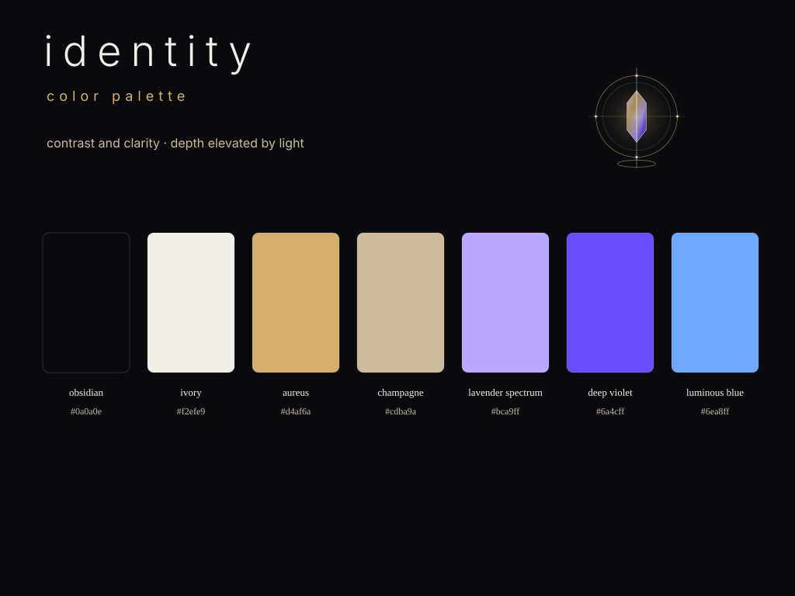

# Product overview

## Product contract

A consumer owns its identity source. Identity validates that source, plans deterministic projections, generates derived artifacts, verifies the result, and records evidence without replacing human creative authority.

```text
project-owned .identity/ intent
        ↓
Identity validate → resolve → plan → render → verify
        ↓
assets/identity/ + versioned packages + Brand Kit view model
        ↓
product consumers + public Brand Kit
```

The canonical Identity Brand Kit is published at
[`https://identity.egohygiene.io/`](https://identity.egohygiene.io/). The
identity repository owns that standalone tool surface; the main
`egohygiene.io` website and Flutter application retain host and homepage
ownership. Identity now defines a content-addressed LaunchKit and Zensical
dogfood artifact for `https://egohygiene.io/identity/` without transferring
brand authority into either framework. See the
[public Brand Kit publication guide](../docs/publication/IDENTITY_PAGES.md).
## Brand Kit preview

The first human-approved self-hosting visual direction lives under [`assets/identity/`](../assets/identity/README.md). These are generated projections. The v1 `.identity/` source contract is implemented. [#99](https://github.com/egohygiene/identity/issues/99) and [#105](https://github.com/egohygiene/identity/issues/105) are closed for their bounded inventory and complete-kit proofs; [#98](https://github.com/egohygiene/identity/issues/98) retains root v1 self-source, rights, release and dogfood acceptance.

Kern, the approved Identity guide, now dogfoods the v1
[mascot and character-system contract](../docs/contracts/MASCOT_SYSTEM_V1.md).
His three glowing eyes represent context, intent, and verified projection; the
identity kernel is integrated into his outfit rather than floating as a prop.

<p align="center">
  
</p>

<p align="center">
  
</p>

<p align="center">
  <a href="../assets/identity/guidelines/design-system.svg">design system board</a> ·
  <a href="../assets/identity/guidelines/usage-guidelines.svg">usage guidelines</a> ·
  <a href="../assets/identity/mascot/manifest.json">mascot package</a> ·
  <a href="../assets/identity/manifest.json">asset manifest</a>
</p>
## The three product layers

| Layer | Responsibility | Primary outputs |
| --- | --- | --- |
| Compiler and contracts | Model, validate, resolve, plan, render, and verify reviewed identity intent | Diagnostics, plans, manifests, and evidence |
| Generated Brand Kit | Project the resolved identity into portable assets and packages | Tokens, marks, metadata, guidance, archives, and typed packages |
| Reference experience | Present and safely preview the generated Brand Kit | Public renderer, downloads, and approval-aware asset studio |

Frameworks, renderers, and providers remain replaceable adapters around these stable layers.
## State and authority

| State | Owner | Meaning |
| --- | --- | --- |
| Canonical | Consumer | Human-reviewed intent under `.identity/` |
| Generated | Identity | Reproducible outputs under `assets/identity/` and released packages |
| Transient | Active interface | Preview, cache, candidate, and work state that cannot silently become canonical |
| Published | Owning surface | An immutable approved release integrated and deployed by the website or consumer repository |
## What Identity owns

- brand contracts, schemas, inheritance, overrides, and compatibility;
- semantic design tokens, voice guidance, metadata, usage rules, and target profiles;
- deterministic asset planning, projection, validation, manifests, and provenance;
- distributable Brand Kit packages and a framework-neutral view model;
- the reference Brand Kit renderer and approval-aware asset studio contract.
## What Identity does not own

- product UI components and templates in the current foundations scope;
  existing Holon scaffolding retains its owner. Future components require a
  concrete need and reviewed ownership/compatibility scope; see the
  [product design-system scope](consumers/PRODUCT_DESIGN_SYSTEM_SCOPE.md);
- organization policy, which belongs to Hygiene;
- shared agent instructions and architecture schemas, which belong to Aether;
- reusable CI/CD implementation, which belongs to Relay;
- consumer source intent or the website deployment shell;
- raw asset archives, generic logo generation, or silent publication of generated creative work.
## Current capability state

The Brand Kit product contract and original toolchain decisions are accepted.
Later proposed ADRs retain their individual status in the
[decision index](decisions/README.md); implementation is not approval. The
extracted CLI, v1 source contract, deterministic compiler core, built-in
projection/package layer, shared quality/evidence harness, governed
visual-motion validation, voice/usage/approval guidance, reference renderer,
asset studio, and Empathy/OptiFlow pilot integrations are implemented.
`v1.0.0` is published as the first stable release, and the release-backed public
Brand Kit is live at [`identity.egohygiene.io`](https://identity.egohygiene.io/).
The separately composed `egohygiene.io/identity/` product experience remains an
independent consumer and deployment transaction.

Current source includes the public/review, source-preflight, and recovery
authority repairs merged through [PR #89](https://github.com/egohygiene/identity/pull/89).
The latest published stable release remains `v1.0.0` and predates the Kern
mascot and later kit additions; use a reviewed source revision for those. Merged implementation,
released artifacts, deployed pages, and accepted ADRs are separate evidence.
The stabilization and complete-kit sequence is maintained in
[ROADMAP.md](../ROADMAP.md). Current source adds `v1-inspect` and `v1-recover` for
supported interruption handling; select an exact reviewed commit or a later
release containing them. #83 retains broader final documentation reconciliation.

The 2026-11-05 source campaign adds review-branch drafts for
[v1 initialization](consumers/V1_INITIALIZATION.md) and the
[native publisher handoff](publication/NATIVE_V1_DRAFT.md). Neither is merged,
runtime-qualified, released or deployed. The actual self-source candidate has
missing rights/creative facts recorded in the [owner packet](work/98/OWNER_PACKET.md).
Refactors, audits, tests and CI qualification are deferred to a separate
campaign; current-main whole-repository acceptance is still pending.

| Capability | State | Tracking |
| --- | --- | --- |
| Brand Kit product contract | Accepted | [#6](https://github.com/egohygiene/identity/issues/6) |
| Toolchain decisions | Accepted | [#7](https://github.com/egohygiene/identity/issues/7), [evaluation](../docs/evaluations/brand-kit-foundations.md), [ADRs](../DECISIONS.md) |
| Independent CLI | Implemented | [#8](https://github.com/egohygiene/identity/issues/8) |
| v1 identity schema | Implemented | [#9](https://github.com/egohygiene/identity/issues/9), [contract](../docs/contracts/IDENTITY_V1.md) |
| Compiler core | Implemented | [#10](https://github.com/egohygiene/identity/issues/10), [contract](../docs/contracts/COMPILER_V1.md) |
| Projection adapters and packages | Implemented | [#11](https://github.com/egohygiene/identity/issues/11), [contract](../docs/contracts/BRAND_KIT_PACKAGES_V1.md) |
| Quality and release evidence | Implemented | [#12](https://github.com/egohygiene/identity/issues/12), [contract](../docs/contracts/QUALITY_GATES_V1.md) |
| Visual-motion validation | Implemented | [#3](https://github.com/egohygiene/identity/issues/3), [contract](../docs/contracts/VISUAL_MOTION_V1.md), [Astryx evaluation](../docs/evaluations/astryx-motion-patterns.md) |
| Voice, usage, and approval guidance | Implemented | [#13](https://github.com/egohygiene/identity/issues/13), [contract](../docs/contracts/GUIDANCE_V1.md) |
| Renderer and asset studio | Implemented | [#14](https://github.com/egohygiene/identity/issues/14), [#15](https://github.com/egohygiene/identity/issues/15) |
| Public Brand Kit site | Release-backed GitHub Pages deployment at `identity.egohygiene.io` | [#16](https://github.com/egohygiene/identity/issues/16), [publication guide](../docs/publication/IDENTITY_PAGES.md) |
| Dogfooded Identity experience | Deterministic LaunchKit + Zensical composite and review-gated `/identity/` handoff | [#57](https://github.com/egohygiene/identity/issues/57), [experience guide](../experience/README.md) |
| Consumer pilots | Implemented | [#17](https://github.com/egohygiene/identity/issues/17), [Empathy #77](https://github.com/egohygiene/empathy/pull/77), [OptiFlow #46](https://github.com/egohygiene/optiflow/pull/46) |
| v1.0.0 release | Published with cross-platform, provenance, SBOM, checksum, and package evidence | [release](https://github.com/egohygiene/identity/releases/tag/v1.0.0), [#18](https://github.com/egohygiene/identity/issues/18), [release guide](../docs/releases/V1.md) |
| Design-system handbook and AI context | Implemented with post-v1 consumer adoption path | [#35](https://github.com/egohygiene/identity/issues/35), [contract](../docs/contracts/DESIGN_SYSTEM_V1.md), [adoption guide](../docs/consumers/ADOPTION.md) |
| Press Kit and Media Kit | Implemented | [#34](https://github.com/egohygiene/identity/issues/34), [contract](../docs/contracts/PRESS_KIT_V1.md) |
| Pinned social-surface packages | Implemented | [#52](https://github.com/egohygiene/identity/issues/52), [contract](../docs/contracts/SOCIAL_SURFACES_V1.md) |
| Repository banners and evidence-badge presentation | Implemented | [#54](https://github.com/egohygiene/identity/issues/54), [contract](../docs/contracts/REPOSITORY_PRESENTATION_V1.md) |

New repositories should follow the [consumer adoption golden
path](../docs/consumers/ADOPTION.md). It preserves human authority, immutable tool
pins, generated-output ownership, drift verification, and rollback as one
repeatable integration boundary. Mantle issue
[#27](https://github.com/egohygiene/mantle/issues/27) is the first post-v1 fleet
adoption of that pattern.

The umbrella [#2](https://github.com/egohygiene/identity/issues/2) records the
compiler/package outcome. The Empathy and OptiFlow proof has landed through
#17; #18 now provides the installable release and evidence boundary.
## Architecture

- [Purpose](../PURPOSE.md)
- [Vision](../VISION.md)
- [Principles](../PRINCIPLES.md)
- [Pillars](../PILLARS.md)
- [System responsibilities](../SYSTEM.md)
- [Architecture and boundaries](../ARCHITECTURE.md)
- [Design system contract](../DESIGN_SYSTEM.md)
- [Architecture decisions](../DECISIONS.md)
- [Brand Kit foundations evaluation](../docs/evaluations/brand-kit-foundations.md)
- [Dependency policy](../docs/DEPENDENCY_POLICY.md)
- [v1 release guide](../docs/releases/V1.md)
- [consumer adoption golden path](../docs/consumers/ADOPTION.md)
- [release process](../docs/releases/RELEASE_PROCESS.md)
- [public Brand Kit publication](../docs/publication/IDENTITY_PAGES.md)
- [security policy](../SECURITY.md)
- [support policy](../SUPPORT.md)
- [Identity v1 source contract](../docs/contracts/IDENTITY_V1.md)
- [Identity authoring worksheet](../docs/consumers/AUTHORING.md)
- [Mantle authoring proof](../docs/consumers/MANTLE_AUTHORING_PROOF.md)
- [Initialization and validation handoffs](../docs/consumers/INITIALIZATION_AND_VALIDATION_HANDOFFS.md)
- [Minimal and expanded v1 authoring examples](../examples/v1/README.md)
- [Identity field catalog and checkpoint 1 review](../docs/reviews/identity-fields-2026-10-18.md)
- [Guidance v1 contract](../docs/contracts/GUIDANCE_V1.md)
- [Compiler v1 contract](../docs/contracts/COMPILER_V1.md)
- [Brand Kit packages v1 contract](../docs/contracts/BRAND_KIT_PACKAGES_V1.md)
- [Quality gates v1 contract](../docs/contracts/QUALITY_GATES_V1.md)
- [Visual-motion v1 contract](../docs/contracts/VISUAL_MOTION_V1.md)
- [Design-system handbook and context contract](../docs/contracts/DESIGN_SYSTEM_V1.md)
- [Press Kit and Media Kit contract](../docs/contracts/PRESS_KIT_V1.md)
- [Social-surface projection contract](../docs/contracts/SOCIAL_SURFACES_V1.md)
- [Repository-presentation projection contract](../docs/contracts/REPOSITORY_PRESENTATION_V1.md)
- [Astryx motion-pattern evaluation](../docs/evaluations/astryx-motion-patterns.md)
- [Roadmap](../ROADMAP.md)

[ROADMAP.md](../ROADMAP.md) owns execution order. [#70](https://github.com/egohygiene/identity/issues/70) tracks stabilization and [#98](https://github.com/egohygiene/identity/issues/98) tracks complete-kit delivery and optional scope decisions; the original [#5](https://github.com/egohygiene/identity/issues/5) remains historical context. Architecture documents define durable boundaries; individual issues own implementation detail and evidence.
