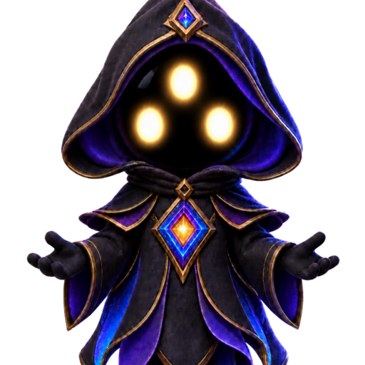

# Kern: optional static mascot example

This selected [#107](https://github.com/egohygiene/identity/issues/107) use case
shows Identity's existing, actually approved mascot as a static supporting
visual. [Open the offline HTML example](index.html) from this checkout; no
server, model, package installation or browser script is required.



Kern character artwork © 2026 Ego Hygiene, created with AI assistance.

The artwork is [CC BY 4.0](https://creativecommons.org/licenses/by/4.0/).
The copyright license does not grant permission to use Ego Hygiene or Identity names, marks, or trade dress as source identifiers.

## Source to kit to consumer

1. The [character source](../../../mascot/kern.character.json),
   [provenance](../../../mascot/provenance.json) and
   [existing approval](../../../mascot/approval.json) identify the canonical
   master, permitted character/usage and actual prior human review.
2. The [existing package manifest](../../../assets/identity/mascot/manifest.json)
   binds that master to three exact PNG variants and its usage guide. These
   files already belong to the source checkout's Brand Kit asset tree.
3. This example references those existing files directly. It uses the reviewed
   portrait at 160 CSS pixels, its exact alternative text and the required
   attribution. It adds no artwork, crop, color transformation or approval.

| Variant | Existing kit file | Dimensions | Minimum displayed width |
| --- | --- | --- | --- |
| Full | [kern-full.png](../../../assets/identity/mascot/kern-full.png) | 768 × 1152 | 320 CSS pixels |
| Portrait | [kern-portrait.png](../../../assets/identity/mascot/kern-portrait.png) | 512 × 512 | 160 CSS pixels |
| Icon | [kern-icon.png](../../../assets/identity/mascot/kern-icon.png) | 256 × 256 | 96 CSS pixels |

The full figure must not be shrunk below its reviewed minimum. Choose a
portrait/icon for narrower layouts, and use the supplied crops unchanged.

## Accessibility and motion

The page keeps a visible heading and description, meaningful link text,
ordinary keyboard-accessible links and the source's exact portrait alternative
text. Kern supplies no status or navigation meaning by himself. A decorative
use beside genuinely equivalent content may instead use the source's empty
`decorativeAlt`; that is a consumer choice, not a reason to remove meaningful
alternative text from this example.

The selected category is static illustration/mascot artwork. No animation is
selected. The approved static image is already the reduced-motion presentation;
there is no motion that must finish before content or navigation is usable.
Actual animated assets need the existing [motion contract](../../../docs/contracts/VISUAL_MOTION_V1.md),
including a real digest-bound fallback where required. This example claims no
browser/assistive-technology or animation qualification.

## Verify the existing package

From the selected Identity checkout:

```bash
python3 scripts/verify_mascot.py --repository-root .
```

The [delivery record](../../../docs/work/107/CLOSEOUT.md) records the actual
package check and static source-to-consumer inspection. The historical stable
release `v1.0.0` predates Kern; this source-checkout example does not add Kern
to that immutable release. Existing #98 owns the next reviewed release and
real self-source/rights/dogfood acceptance. Broader tests/CI remain #70/#80.
